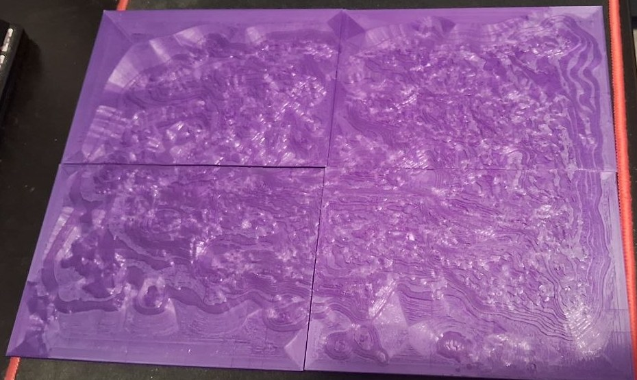
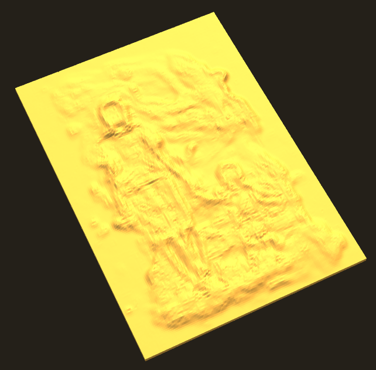
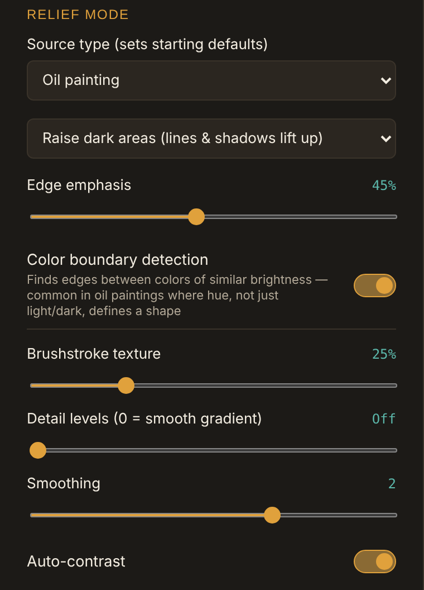
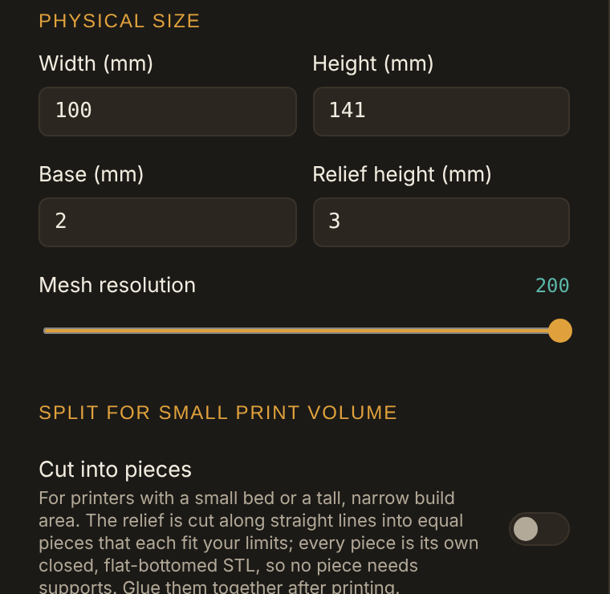
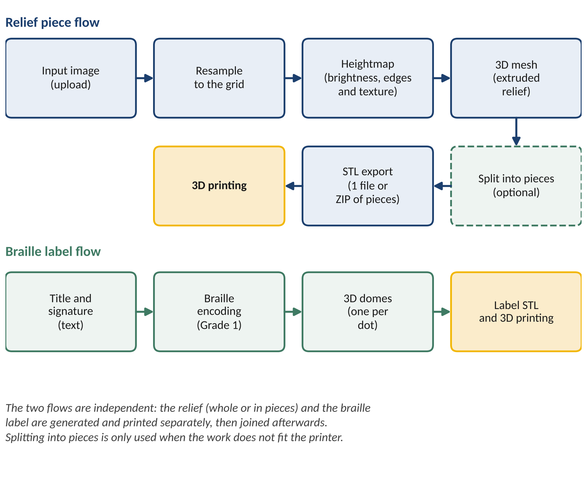

# Seethrough

**Turn a painting into a 3D relief that a blind person can feel.**

Seethrough is a web tool: you upload an image of an artwork, tune the relief and download an **STL** file ready to print on a 3D printer. Everything runs in the browser, with no server and without sending the image anywhere.

▶ **Live demo:** https://fabricio-bertolini.github.io/seethrough/

  

<em>Real prototype: a painting's relief printed in 4 pieces (2 × 2) and glued together.</em>

> Final project, Bachelor's in Information Systems, UNILASALLE-RJ (Niterói, Brazil).

---

## Why it exists

Paintings communicate form through tone and color, so people who can't see are left out of most art. Tactile replicas exist, but they are usually handmade: expensive and rare. Seethrough automates the **image → relief** translation, and was designed to work even on simple 3D printers, because a relief that only an expensive machine can print is of little use.

## What it does

| Feature | Description |
| --- | --- |
| **Oil painting mode** | Detects outlines by **color** (not only brightness) and adds a light brushstroke texture. In oils, different colors can have the same brightness, and the outline vanishes if only light and dark are used. |
| **Raised outline, or the opposite** | You choose whether the dark parts (lines and shadows) rise, or the light parts do. |
| **Simple printer mode** | Limits resolution (≤ 80), forces smoothing and uses relief and base of at least 2.5 mm, to stay readable to the touch on wide-nozzle printers. |
| **Cut into pieces** | For works larger than the print bed: splits the relief into a grid, exports one STL per piece in a ZIP with an assembly guide, and the joint leaves no step. Supports round beds. |
| **Braille label** | Generates a plate with the title and the artist's name, in Grade 1 braille, as a separate STL. |
| **3D preview** | Rotate and check the relief before downloading. |

  
  &nbsp;
  
  &nbsp;
  

## How to use

1. Open the [live demo](https://fabricio-bertolini.github.io/seethrough/), or the `index.html` file in your browser.
2. Drag the artwork image onto the page.
3. Pick the type (for example, *Oil painting*), set the size in mm and, if the printer is basic, turn on **Simple printer mode**.
4. If the work doesn't fit on the bed, turn on **Cut into pieces** and enter the usable area.
5. Click **Download relief STL** and slice the file in your printer's software.

> The interface is in English. The app is a single HTML file, no installation. An internet connection is needed when opening it, because the preview loads the three.js library from a CDN.

## How it works

  

1. **Resampling:** the image becomes a grid of points (adjustable resolution, up to 200).
2. **Heightmap:** each point gets a height from brightness, edges and, optionally, a brushstroke texture.
3. **Color edges:** the Sobel filter is applied to luminance and to two color differences (R − L and B − L), and the three are combined.
4. **Watertight mesh:** top, flat bottom and four walls form a closed solid that prints lying down and without supports.
5. **Export:** binary STL, written in the browser itself. In cut mode, a ZIP with one STL per piece.
6. **Braille:** text becomes cells (Grade 1) and each dot is a 3D dome on a plate, as a separate STL.

The other diagrams are in [`docs/images/diagrams`](docs/images/diagrams), and the full description is in the project proposal.

## Tech

Plain HTML, CSS and JavaScript in a single file · Canvas API for image processing · [three.js](https://threejs.org/) (r128) for the preview · binary STL and ZIP (with CRC32) generation written by hand.

## Status and known limits

- ✅ The program is complete and was checked with automated tests (closed pieces, volumes summing to the total, intact ZIP).
- ✅ A **printed prototype** in 4 pieces already exists.
- ⏳ **Not yet tested with blind people.** This is the most important next step, because only they can say whether the relief is legible.
- On the printed pieces, the seams still show and the corners came out chamfered. It is not yet known whether the cause is the image or the cut.
- Braille covers letters, digits and basic punctuation. **Accented letters are written without the accent** (for example, "é" becomes "e"); the dedicated Portuguese cells are future work.

## Documentation

- 📄 [Project proposal (PDF)](docs/Project-Proposal.pdf), with background, objectives, schedule and diagrams.
- 📊 [Presentation (PPTX)](docs/Presentation.pptx)

## License

[MIT](LICENSE) © 2026 Fabrício Valladares Bertolini
