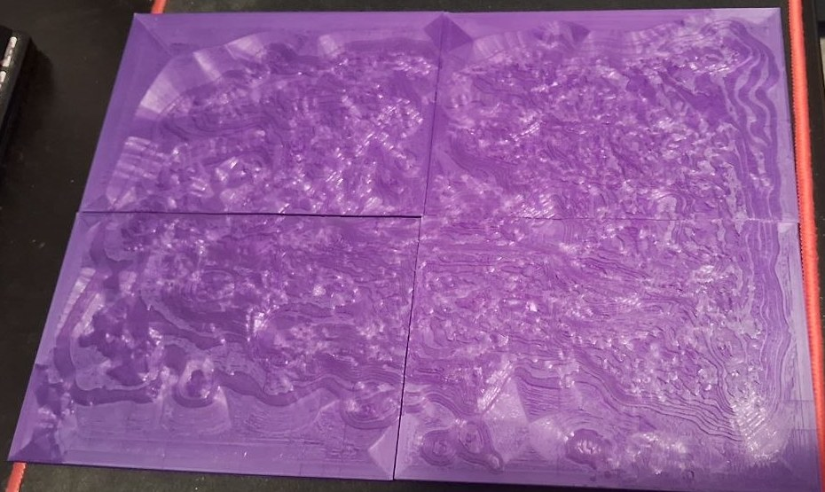
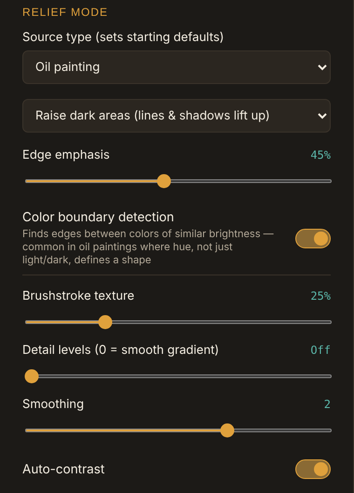
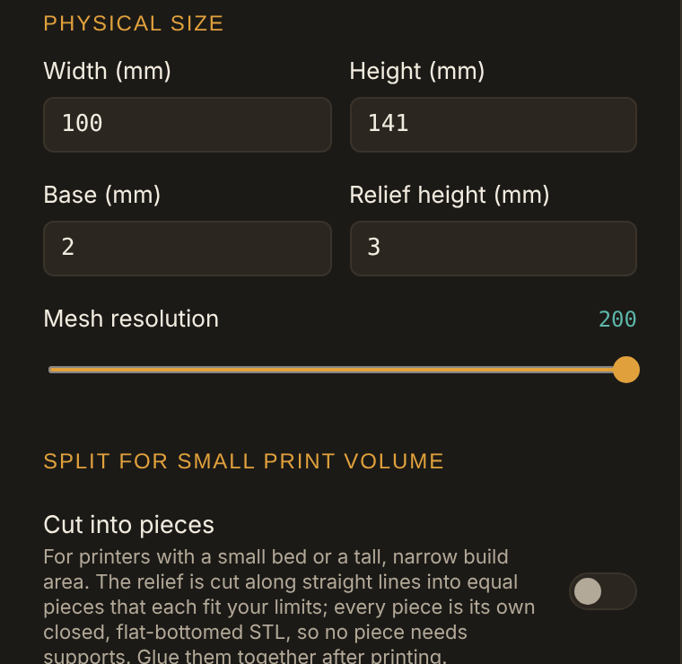
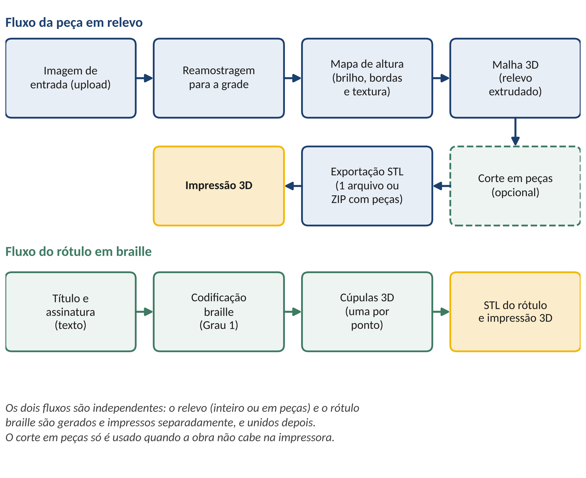

# Seethrough

**Transforme uma pintura em um relevo 3D que uma pessoa cega consegue sentir.**

O Seethrough é uma ferramenta web: você envia a imagem de uma obra, ajusta o relevo e baixa um arquivo **STL** pronto para imprimir em uma impressora 3D. Tudo roda no navegador, sem servidor e sem enviar a imagem para lugar nenhum.

▶ **Demo online:** https://fabricio-bertolini.github.io/seethrough/

  

<em>Protótipo real: relevo de uma pintura impresso em 4 peças (2 × 2) e coladas.</em>

> Projeto Final de Sistemas de Informação, UNILASALLE-RJ (Niterói).

---

## Por que existe

Pinturas comunicam forma por tom e por cor, então quem não enxerga fica de fora da maior parte da arte. Réplicas táteis existem, mas costumam ser feitas à mão: caras e raras. O Seethrough automatiza a tradução **imagem → relevo**, e foi pensado para funcionar mesmo em impressoras 3D simples, porque de nada adianta um relevo que só uma máquina cara consegue imprimir.

## O que ele faz

| Recurso | Descrição |
| --- | --- |
| **Modo pintura a óleo** | Detecta contornos pela **cor** (e não só pelo brilho) e adiciona uma textura leve de pinceladas. Em óleo, cores diferentes podem ter o mesmo brilho, e o contorno some se só o claro e escuro forem usados. |
| **Contorno em relevo, ou o contrário** | Você escolhe se as partes escuras (linhas e sombras) sobem, ou se as claras sobem. |
| **Modo impressora simples** | Limita a resolução (≤ 80), força suavização e usa relevo e base de pelo menos 2,5 mm, para continuar legível ao toque em impressoras de bico largo. |
| **Corte em peças** | Para obras maiores que a mesa de impressão: divide o relevo em grade, exporta um STL por peça num ZIP com guia de montagem, e a junção não deixa degrau. Aceita mesa circular. |
| **Etiqueta em braille** | Gera a placa com o título e o nome do artista, em braille Grau 1, como STL separado. |
| **Pré-visualização 3D** | Gira e confere o relevo antes de baixar. |

  
  &nbsp;
  
  &nbsp;
  

## Como usar

1. Abra a [demo online](https://fabricio-bertolini.github.io/seethrough/), ou o arquivo `index.html` no navegador.
2. Arraste a imagem da obra para a página.
3. Escolha o tipo (por exemplo, *Oil painting*), ajuste o tamanho em mm e, se a impressora for básica, ative o **Simple printer mode**.
4. Se a obra não cabe na mesa, ative **Cut into pieces** e informe a área útil.
5. Clique em **Download relief STL** e fatie o arquivo no programa da sua impressora.

> A interface está em inglês. O arquivo é um único HTML, sem instalação. É preciso internet ao abrir, porque a pré-visualização carrega a biblioteca three.js de um CDN.

## Como funciona

  

1. **Reamostragem:** a imagem vira uma grade de pontos (resolução ajustável, até 200).
2. **Mapa de altura:** cada ponto ganha uma altura a partir do brilho, das bordas e, opcionalmente, de uma textura de pinceladas.
3. **Bordas por cor:** o filtro de Sobel é aplicado à luminância e a duas diferenças de cor (R − L e B − L), e as três são combinadas.
4. **Malha estanque:** topo, fundo plano e quatro paredes formam um sólido fechado, que imprime deitado e sem suportes.
5. **Exportação:** STL binário, escrito no próprio navegador. Em modo de corte, um ZIP com um STL por peça.
6. **Braille:** o texto vira células (Grau 1) e cada ponto é uma cúpula 3D sobre uma placa, em STL separado.

Os demais diagramas estão em [`docs/images/diagramas`](docs/images/diagramas), e a descrição completa está no anteprojeto.

## Tecnologias

HTML, CSS e JavaScript puro em um único arquivo · Canvas API para o processamento de imagem · [three.js](https://threejs.org/) (r128) para a pré-visualização · geração de STL binário e de ZIP (com CRC32) escrita à mão.

## Status e limites conhecidos

- ✅ O programa está completo e foi testado com testes automatizados (peças fechadas, volumes somando o total, ZIP íntegro).
- ✅ Já existe um **protótipo impresso** em 4 peças.
- ⏳ **Ainda não foi testado com pessoas cegas.** É o passo mais importante, porque só elas podem dizer se o relevo é legível.
- Nas peças impressas, as emendas ainda aparecem e os cantos saíram chanfrados. Ainda não se sabe se a causa é a imagem ou o corte.
- O braille cobre letras, dígitos e pontuação básica. **Letras acentuadas são escritas sem o acento** (por exemplo, "é" vira "e"); as células próprias do português ficam como melhoria futura.

## Documentação

- 📄 [Anteprojeto (PDF)](docs/Anteprojeto.pdf), com fundamentação, objetivos, cronograma e diagramas.
- 📊 [Apresentação (PPTX)](docs/Apresentacao.pptx)

## Resumo em inglês

**Seethrough** is a client-side web tool that turns an image, especially an oil painting, into a 3D-printable relief (STL) so blind people can feel the artwork. It detects edges from both brightness and color, has a simple-printer mode for low-end FDM machines, can cut large reliefs into printable tiles with an assembly guide, and generates a Grade 1 braille label. Everything runs in the browser. A physical prototype printed in four glued tiles exists; tactile testing with blind readers is the next step.

## Licença

[MIT](LICENSE) © 2026 Fabrício Valladares Bertolini
